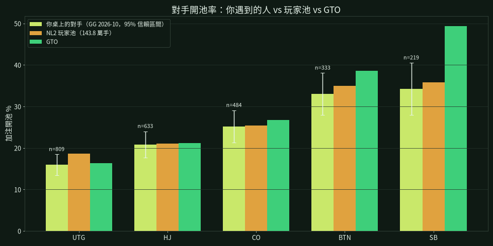
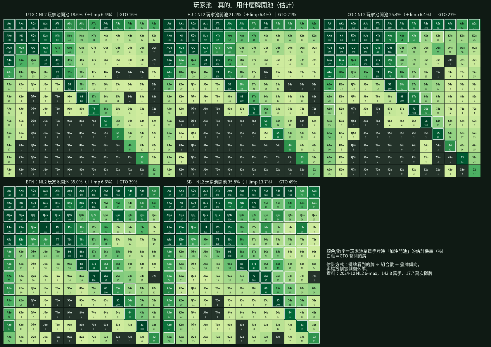
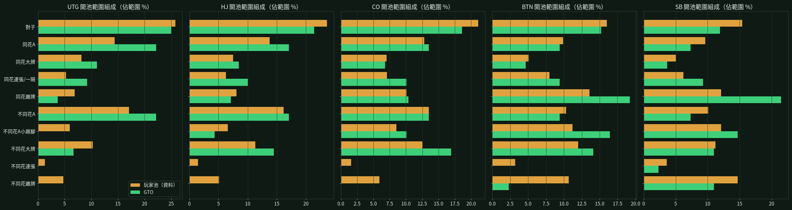
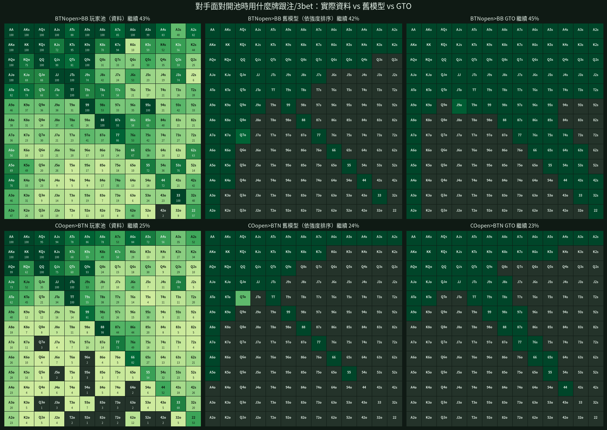
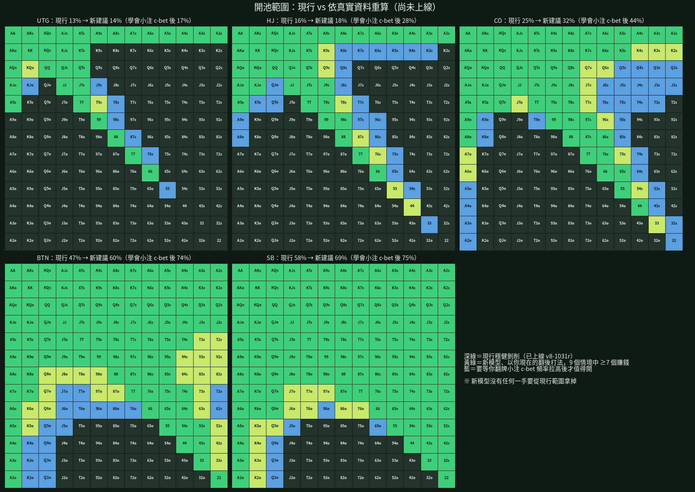
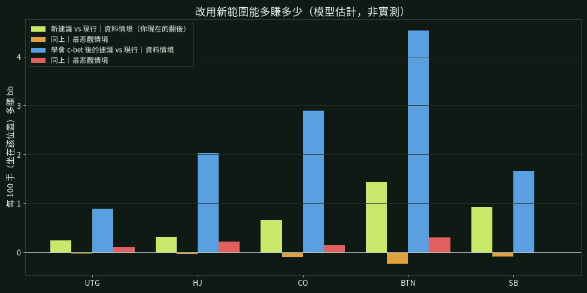

# 對手到底用什麼牌開池？依真實資料重算的剝削（exploit v2）

更新：2026-10-31 00:30（台北時間）｜分析檔，**沒有上線**（網站仍是 v8-1031r 穩健剝削）

## 結論先講

1. **對手的開池「頻率」大致正常，「內容」才是重點。** NL2 玩家池的開池率（UTG 18.6％、HJ 21.1％、CO 25.4％、BTN 35.0％、SB 35.8％）跟 GTO（16／21／27／39／49％）差不多，另外每個位置都有約 6–7％ 平跛（SB 13.7％）。
   - 早位（UTG/HJ）用小對子、不同花的 A 小踢腳和 KTo/QJo/JTo 這類雜牌開池。
   - 但他們少開同花連張和同花 A2s–A5s。
   - 後位（BTN/SB）開得比 GTO 緊：SB 少了 13 個百分點，改成平跛。
2. **你桌上的對手（GG，2026-10）跟這個玩家池幾乎一模一樣。** 開池率和面對開池時的棄牌率都在信賴區間內，所以 2024 年 NL2 玩家池的資料可以拿來用在你身上。
3. **最有用的發現在「防守」那一邊：** 他們面對你開池時，用來跟注或 3bet 的牌有 17–50％ 是 GTO 會棄掉的雜牌，又把 20–38％ 該繼續的牌棄掉了。
   - 舊模型假設「對手只用最強的那 X％ 繼續」，太看得起他們了。
   - 用真實組成重算後，每個位置的最佳開池都變寬。
4. **不過以你現在的翻後打法，多開能多賺的不多。** 我建議**先不要改**網站上的範圍。
   - 新建議：UTG 14％、HJ 18％、CO 32％、BTN 60％、SB 69％。
   - 新模型認為現行範圍裡的牌都還是該開，沒有任何一手要拿掉；只是 9 個情境中有 ≥7 個認為可以再加幾手。
   - 多開的好處只有約 **+0.6 bb/100**（模型估計）。最悲觀情境下約 −0.1 bb/100，等於打平。
5. **真正的錢在翻牌。** 玩家池面對開池者的小注 c-bet（≤33％ 底池）會棄 38.7％。純詐唬只要對手棄超過 25％ 就賺，所以每次空氣牌小注 c-bet 大約賺 **0.18 個底池**。
   - 你的 c-bet 頻率是 37％（n=107），玩家池是 61％。這塊錢你大部分沒拿到。
   - 如果你把翻牌小注 c-bet 拉高，開池範圍就值得再加寬（UTG 17％、HJ 28％、CO 44％、BTN 74％、SB 75％），多賺約 **+2.0 bb/100**（最悲觀情境也還有 +0.1）。
   - 但這 +2 bb/100 大多來自翻牌打法本身，不是來自翻前多開。
6. **你目前的實際開池比現行建議還緊：** CO 偷盲 16％（建議 25.5％）、BTN 32％（建議 46.6％）、SB 38.5％（建議 58.4％）。先把現行範圍確實執行，比改範圍重要。

**建議順序：** ① 照網站上現行的穩健剝削範圍開 → ② 翻牌在乾燥牌面多用 1/3 底池 c-bet → ③ 再回來把範圍換成「學會 c-bet 後」那一版。

---

## A. 已上線（穩健剝削，v8-1031r）

| | |
|---|---|
| 訓練網站 | poker-trainer commit `0eb5784`，2026-10-31 約 00:16（台北時間）推上 main |
| 分析檔 | poker-solver commit `8879143`（rfi_audit/、robust_v1/） |

- 開池範圍：UTG 13.1％、HJ 15.8％、CO 25.5％、BTN 46.6％、SB 58.4％。
- GTO 切換、大字體都保留；SW 快取版本為 poker-v8-1031a。
- 截圖在 `/workspace/poker_mb/rfi_robust/live/`。

---

## B. 對手到底用什麼牌開池

**資料來源：**
- 玩家池：2024-10 NL2 6-max 原始手牌，724 個檔，只保留滿 6 人、正常盲注的牌局。
  - 共 **1,438,424 手**、**177,483 筆攤牌**。
  - 其中 6,897 位玩家打了 ≥200 手。
- 你的牌局：GG/Natural8 2026-10-29、10-29b、10-30，共 **1,562 手**（6 人桌 985 手）、256 個對手 ID。

### B1. 開池率、平跛率、尺寸（玩家池）

| 位置 | 機會數 | 開池 | 平跛 | VPIP/PFR | GTO 開池 | 2bb | 2.1–2.5bb | 2.6–3bb | >3bb |
|---|---|---|---|---|---|---|---|---|---|
| UTG | 1,327,842 | 18.6％ | 6.4％ | 23.1/17.4 | 16.3％ | 34％ | 27％ | 33％ | 7％ |
| HJ | 1,038,227 | 21.1％ | 6.4％ | 24.4/17.2 | 21.2％ | 32％ | 29％ | 33％ | 7％ |
| CO | 785,663 | 25.4％ | 6.4％ | 26.5/17.7 | 26.8％ | 29％ | 34％ | 31％ | 6％ |
| BTN | 570,564 | 35.0％ | 6.6％ | 31.5/19.8 | 38.6％ | 26％ | 38％ | 31％ | 6％ |
| SB | 333,527 | 35.8％ | 13.7％ | 31.9/14.7 | 49.3％ | 22％ | 18％ | 53％ | 7％ |

**你桌上的對手（6 人桌）：**

| 位置 | 你桌上的對手 | 玩家池 | 你的樣本 n |
|---|---|---|---|
| UTG | 15.9％ ±2.5 | 18.6％ | 809 |
| HJ | 20.9％ ±3.2 | 21.1％ | 633 |
| CO | 25.2％ ±3.9 | 25.4％ | 484 |
| BTN | 33.0％ ±5.1 | 35.0％ | 333 |
| SB | 34.2％ ±6.3 | 35.8％ | 219 |

- 面對開池時的棄牌率，15 個節點（n≥59）全部落在 95％ 信賴區間內。例如 BTN 開 → BB 棄 58％（n=86），玩家池是 57％。
- 開池尺寸以 2bb 最多（UTG：2bb 54 次、2.5bb 39 次、3bb 20 次）。

### B2. 開池範圍的內容（從攤牌估計）

**比 GTO 多開的牌：**

| 位置 | 多開的牌（估計開池頻率） |
|---|---|
| UTG | 55（65％）、33（56％）、44、22、KJo（47％）、QJo、KTo（約 30％）、A9o–A4o（16–21％） |
| HJ | 44、33（約 60％）、A5o、JTo、QTo、A8o–A2o（12–25％） |
| CO | 33（91％）、JTo（42％）、A5o–A3o（約 30％）、K9o、T9o、Q5s |
| BTN | A2o、Q9o、T9o、K5o、98o、J9o、87o、76o（約 20–30％） |
| SB | K5o–K2o、J8o、87o、97o、T8o（約 20％） |

- 「不同花雜牌」在 UTG 開池範圍裡佔約 4.5％，GTO 是 0。
- 這是一個平均值：有一小群鬆的玩家會開這些牌。在 ≥200 手的玩家裡，353 人 VPIP ≥45％，1,347 人在 30–45％。

**比 GTO 少開的牌：**

| 位置 | 少開的牌（估計開池頻率） |
|---|---|
| UTG | T8s、98s、87s（25–38％）、A2s/A3s（約 45％）、ATo（56％）、KQo（70％） |
| HJ | 97s、J8s、T8s、76s（20–36％）、A9o（35％）、KTo（37％） |
| CO | A7o/A8o（約 27％）、QTo（29％）、K5s/K6s（16–23％）、T7s、86s |
| BTN | K9o（25％）、A4o–A7o（約 50％）、JTo/QTo（約 57％） |
| SB | K6o–K9o（9–26％）、J9o、Q9o、T9o（約 30％）；這些牌很多改成平跛 |

**平跛的牌：** 不同花雜牌（18–31％）、同花雜牌（約 16％）、小對子（10–17％）為主。

### B3. 他們面對開池時用什麼牌繼續（最重要）

| 節點 | 樣本 | 棄/跟/3bet | 玩家池繼續 | GTO 繼續 | 繼續的牌中「GTO 會棄」的比例 | 「GTO 該繼續」卻棄掉 |
|---|---|---|---|---|---|---|
| UTG 開 → BB | 93,881 | 63/32/5 | 37.1％ | 27.0％ | 44％ | 27％ |
| HJ 開 → BB | 99,541 | 62/33/6 | 38.3％ | 31.1％ | 40％ | 29％ |
| CO 開 → BTN | 199,800 | 75/17/8 | 24.7％ | 23.1％ | 34％ | 33％ |
| CO 開 → BB | 111,661 | 60/34/7 | 40.4％ | 35.1％ | 37％ | 30％ |
| BTN 開 → SB | 199,609 | 73/18/9 | 27.5％ | 29.9％ | 30％ | 40％ |
| BTN 開 → BB | 144,716 | 57/35/8 | 42.6％ | 45.3％ | 28％ | 35％ |
| SB 開 → BB | 119,539 | 53/37/10 | 46.9％ | 58.7％ | 17％ | 38％ |

- 15 個節點的總頻率跟模型原本用的數字誤差都在 1 個百分點以內。
- 舊模型（v1）假設對手「依牌力排序，只用最強的那一段繼續」。實際上他們的繼續範圍裡混了大量雜牌（例如 BB 對 BTN 會用 J5o 約 21％、93o 約 16％ 繼續），同時又棄掉不少好牌。
- 所以你開池後在翻後遇到的範圍比舊模型以為的弱。開池變寬，主要就是這個原因：
  - 只換「跟注組成」：CO 32→47％。
  - 只換「3bet 組成」：CO 32→29％（他們 3bet 的牌比較偏價值）。

### B4. 可信度檢查

- **分半檢驗：** 依玩家名字把資料拆成兩半，各自估計組成。
  - 開池組成：兩半的差距最多 1.5 個百分點。
  - 防守組成：最多 4.4 個百分點。
- **攤牌傾向校正的敏感度：** 完全不校正（直接用攤牌次數）、校正一半、完全校正，三種做法的最佳開池都很接近，結論不變。
  - CO：38／39／42％。
  - BTN：71／72／75％。
- **偏差方向：** 跟注後在翻牌就棄的雜牌看不到，所以對手繼續範圍裡的雜牌**只會更多，不會更少**。這會讓「開寬一點」的結論更穩，不會反過來。

---

## C. 更深一層的剝削（沒有上線）

### 方法

- **資料鎖定：** 在你開池後的每個防守節點，對手用 B3 估出來的逐手跟注／3bet 機率行動，再縮放到各情境的目標頻率。其他節點維持原本的模型。
- **第 1 層（玩家池翻後）：** 在單次加注底池（SRP）裡你是開池者。我依玩家池面對 1/3 底池 c-bet 的棄牌率，加了一個額外的底池佔比 γ。
  - 有位置：棄牌 38.7％，純詐唬每次賺 0.185 底池。
  - 沒位置：棄牌 30.4％，每次賺 0.075 底池。
  - 再乘上約 45％ 的「翻牌沒中」比例，得到滿額 γ：有位置 0.083 底池、沒位置 0.033 底池。
  - 套用方式：你的底池佔比 E → E + 2γ(1−E)。中得越少的牌，從詐唬拿到的越多。
  - 轉牌和河牌的超額棄牌比較小（轉牌 2/3 底池時棄 46％ vs 損益平衡點 40％），沒有算進去，這是保守的做法。
- **第 2 層（你本人）：** 你的翻牌 c-bet 是 37.4％（n=107，95％ 信賴區間 29–47％）。
  - 假設約 30％ 的 c-bet 是價值注，理想的剝削頻率是約 75％。
  - 這樣算你現在只拿到約 **16％** 的 γ（信賴區間內是 0–38％）。
- **穩健篩選：** 每種 γ（0／你現在／滿額）都跑 9 個情境：資料鎖定原樣、往 GTO 靠攏 50％、對手會適應、你的翻後折扣 5％、以及這些的組合，加上舊的依牌力排序模型和 GTO 形狀模型。
  - 「建議」＝9 個情境中至少 7 個賺。
  - 「核心」＝9 個全賺。

### 結果：開池範圍

| 位置 | 現行（已上線） | 新建議（你現在的翻後） | 新核心 | 學會小注 c-bet 後的建議 | 學會後的核心 |
|---|---|---|---|---|---|
| UTG | 13.1％ | 14.3％ | 13.1％ | 17.2％ | 15.8％ |
| HJ | 15.8％ | 18.3％ | 15.8％ | 27.8％ | 22.8％ |
| CO | 25.5％ | 31.7％ | 26.1％ | 44.5％ | 36.7％ |
| BTN | 46.6％ | 59.6％ | 49.3％ | 73.8％ | 62.9％ |
| SB | 58.4％ | 69.2％ | 61.1％ | 74.7％ | 67.4％ |

**以你現在的打法，新增的牌：**

| 位置 | 新增 |
|---|---|
| UTG | KQo、T9s |
| HJ | K9s、Q9s、T8s、87s、76s、55、44 |
| CO | K4s–K2s、Q7s、Q6s、J7s、JTo、T7s、96s、A7o、A6o、75s、54s、33 |
| BTN | T3s、T2s、94s–92s、84s–82s、73s、63s、52s、42s、32s、Q8o、J8o、T8o、98o、Q7o、97o、87o、K6o、Q6o、K5o |
| SB | J7o、T7o、97o、J6o、T6o、86o、76o、K5o、Q5o、K4o–K2o |

- 學會小注 c-bet 後的完整牌表在 `data/final_v2.json`（ `gfull.rec_cells`）。
- 新模型沒有要從現行範圍拿掉任何一手。

### 結果：EV（每 100 手坐在該位置、相對於全部棄牌，單位 bb；模型估計）

| 位置 | 情境 | 現行範圍 | 新建議 | 該情境的最佳解 |
|---|---|---|---|---|
| UTG | 資料情境，你現在的翻後 | +14.81 | +15.05 | +15.34 |
| HJ | 同上 | +13.51 | +13.83 | +14.38 |
| CO | 同上 | +13.56 | +14.22 | +14.72 |
| BTN | 同上 | +15.63 | +17.07 | +17.95 |
| SB | 同上 | +13.60 | +14.53 | +15.38 |
| BTN | 最悲觀情境（GTO 形狀＋對手適應＋翻後折扣） | +11.04 | +10.81 | +11.06 |
| BTN | 學會 c-bet 後，資料情境 | +18.34 | +22.87（該情境的建議） | +24.71 |

換算成整體（6 個位置平均）：

| 情況 | 新範圍比現行多賺 |
|---|---|
| 你現在的翻後，資料情境 | 約 +0.6 bb/100 |
| 你現在的翻後，最悲觀情境 | 約 −0.1 bb/100 |
| 學會小注 c-bet 後，資料情境 | 約 +2.0 bb/100 |
| 學會小注 c-bet 後，最悲觀情境 | 約 +0.1 bb/100 |

### 你自己的數據（第 2 層參考）

- 總計 1,562 手，**+36.8 bb/100**。
  - 攤牌贏 $11.26，沒攤牌只贏 $0.22，幾乎所有的錢都是在攤牌時拿到的。
  - 這代表你很少靠下注把對手打走。這正好是第 1 層說的那塊沒拿到的錢。
- 翻牌 c-bet 37％（玩家池 61％）；面對 c-bet 棄牌 54％（n=37，玩家池 47.5％）。
- 各位置的 bb/100：

  | UTG | HJ | CO | BTN | SB | BB |
  |---|---|---|---|---|---|
  | +47 | −16 | +29 | +74 | +62 | +22 |

  - 每個位置只有 170–290 手，95％ 信賴區間大約是 ±120 bb/100，**還看不出任何位置真的好或真的差**。所以這些數字沒有直接拿來調整模型，只用 c-bet 頻率當作第 2 層的比例。

---

## 缺的資料和限制

- **蓋牌的手看不到：** 玩家池只能從攤牌看到底牌。棄掉、或翻後被打走的牌只能靠「攤牌傾向」校正來推估。
  - 校正的基準是「BB 在平跛底池過牌」，這個範圍裡少了 BB 會加注的強牌，所以前 15％ 的牌改用相近牌型的數值代替。
- **開池尺寸和牌力的關係還沒做：** 攤牌紀錄沒有存尺寸。2bb 和 3bb 開池的範圍是否不同，要再解析一次原始檔才能回答。
- **沒有每位玩家的 WTSD：** 玩家池也沒有整體 WTSD，所以第 1 層用的是 c-bet 棄牌率，不是攤牌率。
- **你這邊的樣本很小：** GG 的 ID 是雜湊過的，同一個對手最多只有 78 手。沒辦法針對個別玩家做剝削，只能用玩家池的平均。
- **翻後是簡化模型：** 第 1 層的 γ 是一個簡化，沒有真的去解翻後。轉牌和河牌的超額棄牌沒算。「翻牌沒中」的 45％ 是估計值。
- **時間和平台不同：** 玩家池是 2024 年 ONG 的資料，你打的是 2026 年 GG。B1 的比對顯示兩邊幾乎一樣，但兩者不是同一批人。

## 檔案

全部在 `/workspace/outputs/poker_solver/exploit_v2/`：

| 檔案 | 內容 |
|---|---|
| `parse_pool.py` → `data/pool_parsed.pkl` | 玩家池解析 |
| `analyze_pool.py` → `data/pool_ranges.json` | 各位置開池、平跛、尺寸、逐手估計、組成、防守節點 |
| `validate_pool.py` → `data/validate_pool.json` | 分半檢驗、總頻率比對 |
| `prop_sens.py` → `data/prop_sens.json` | 攤牌傾向校正的敏感度 |
| `hw_opps.py` → `data/hw_opps.json` | 你桌上的對手 |
| `solve_v2.py` → `data/solve_v2.json` | 5 個位置 × 3 種 γ × 9 個情境的逐手 dEV |
| `decomp.py` → `data/decomp.json` | 跟注組成和 3bet 組成各自的影響 |
| `final_v2.py` → `data/final_v2.json` | 建議／核心範圍、EV 表、和現行範圍的差異 |
| `charts_v2.py` → `charts/*.png` | 圖表 |
