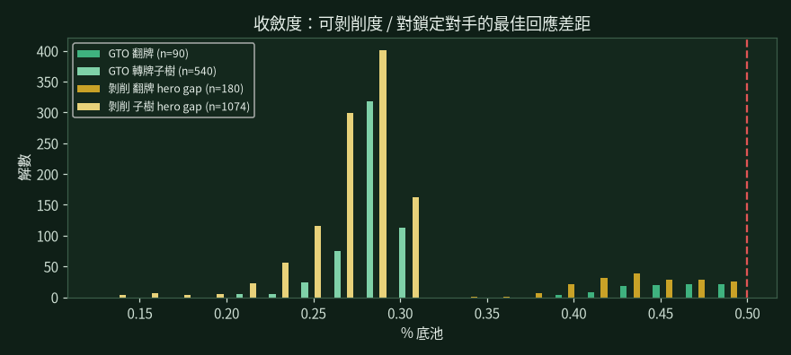
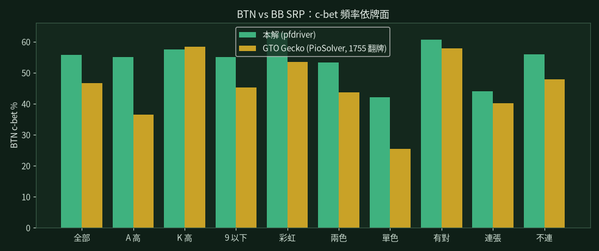
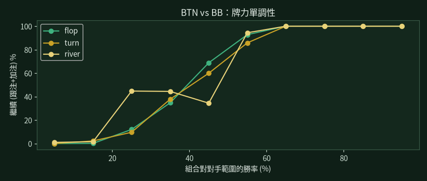
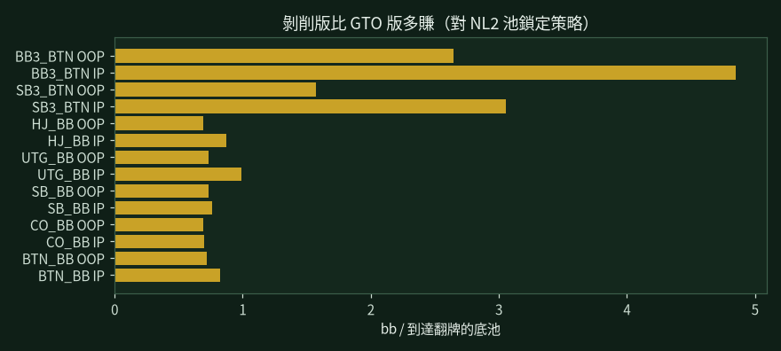

# 翻後 CFR 解 + 練習（v8 翻後模組）— 驗證報告

產生時間：2026-10-30 16:30（台北時間 UTC+8）。**尚未部署／推送**，等 HW 審閱。

## 1. 解了什麼

| 局面 | 底池類型 | 翻牌前加注者 | 解的翻牌數 |
|---|---|---|---|
| BTN_BB（BB vs BTN） | SRP | IP | 30 |
| CO_BB（BB vs CO） | SRP | IP | 12 |
| SB_BB（SB vs BB） | SRP | OOP | 12 |
| UTG_BB（BB vs UTG） | SRP | IP | 8 |
| HJ_BB（BB vs HJ） | SRP | IP | 8 |
| SB3_BTN（SB vs BTN） | 3BP | OOP | 10 |
| BB3_BTN（BB vs BTN） | 3BP | OOP | 10 |

* 引擎：b-inary/postflop-solver（Rust，DCFR，AGPL-3.0，未修改），由自寫 driver `pfdriver` 呼叫；網站只發佈**產生的策略資料**，不含 solver 程式碼。
* 5% 抽水、上限 10bb（Natural8 NL2）；有效籌碼 100bb；HU 底池。
* 起手範圍：v8 `pf_data` 的翻前解（GTO 版用 GTO 範圍；剝削版用 hero 剝削範圍 vs NL2 池範圍）。
* 翻牌：從 1,755 種同構翻牌（權重合計 22,100）依牌面特徵排序後**系統抽樣**，每個抽中的翻牌代表相同出現機率。
* 樹（粗樹，求翻牌策略）：翻前加注者翻牌下注 33% / 75%（不允許 donk）；加注 3x 或全下（一次加注後只剩全下）；轉牌 66%、河牌 75%，後街加注 = 全下。
* 轉牌細解（子樹）：每個翻牌取 3 張轉牌（隨機、固定種子），對「主要 c-bet 線」與「過牌過牌線」重解：轉牌 50%/100%，河牌 50%/100%/全下，加注 = 全下；起始範圍 = 翻牌解在轉牌根節點的實際範圍；IP 最後下注時轉牌根不允許 OOP donk（`root_no_bet`）。河牌每條線取 2 張，網站使用第 1 張。
* 收斂目標：翻牌樹 0.5% 底池、子樹 0.3% 底池。
* 剝削版：先解到 1.25% 再把對手鎖成 NL2 池頻率（n ≥ 500 的節點；下注節點同時鎖 NL2 池的**尺寸分佈**），再讓 hero 解最佳回應到 hero gap ≤ 0.5%（子樹 0.3%）。

## 2. 收斂度

| 解 | 數量 | 中位 | p90 | 最大 |
|---|---|---|---|---|
| GTO 翻牌樹 | 90 | 0.460% | 0.490% | 0.499% |
| GTO 轉牌子樹 | 540 | 0.285% | 0.297% | 0.300% |
| 剝削 翻牌樹 (hero gap) | 180 | 0.442% | 0.489% | 0.500% |
| 剝削 轉牌子樹 (hero gap) | 1074 | 0.276% | 0.295% | 0.300% |

## 3. 和公開數據比較

**參考：GTO Gecko（PioSolver，BTN vs BB SRP 100bb，5% 抽水上限 4bb，33%/75% 兩種尺寸，無 donk，1,755 翻牌依出現率加權）**；GTO Wizard（NL500 general，BTN c-bet 約 54%，BB 對小 c-bet 過牌加注約 17.5%）。

### 3.1 BTN vs BB c-bet 依牌面

| 牌面 | 翻牌數 | 本解 c-bet | 本解 33% | GTO Gecko c-bet | Gecko 33% | 本解 BB 過牌加注 vs 33% |
|---|---|---|---|---|---|---|
| 全部 | 30 | 55.7% | 36.3% | 46.6% | 27.8% | 20.9% |
| A 高 | 7 | 55.1% | 18.7% | 36.5% | – | 13.4% |
| K 高 | 5 | 57.5% | 46.9% | 58.3% | – | 18.6% |
| Q/J/T 高 | 11 | 55.7% | 38.2% | 45–50 | – | 21.9% |
| 9 以下 | 7 | 55.1% | 43.5% | 45.3% | – | 28.3% |
| 彩虹 | 11 | 62.9% | 45.1% | 53.5% | 32.8% | 24.0% |
| 兩色 | 16 | 53.3% | 30.0% | 43.7% | 24.8% | 20.3% |
| 單色 | 3 | 42.0% | 37.8% | 25.5% | 19.9% | 12.2% |
| 無對 | 24 | 54.5% | 31.9% | – | – | 18.5% |
| 有對 | 6 | 60.7% | 54.2% | 57.9% | 47.6% | 30.2% |
| 連張 | 3 | 44.1% | 37.0% | 40.2% | 22.2% | 17.5% |
| 不連 | 21 | 56.0% | 31.1% | 47.9% | – | 18.7% |

### 3.2 同一張翻牌直接對照（GTO Gecko 公開的板面）

| 翻牌 | 本解 c-bet (33% / 75%) | GTO Gecko c-bet (33%) |
|---|---|---|
| Ks7h2d | 84.9% (84.8 / 0.1) | 82.9% (70.0) |
| As7h2d | 53.1% (52.1 / 1.0) | 40.0% (35.0) |
| Ks8s3s | 27.9% (23.2 / 4.6) | 27.7% |
| 8s8h3d | 84.8% (84.5 / 0.4) | 76.5% |

敏感度測試：A♠7♥2♦ 改用更細的轉/河樹（轉牌 33%/75%＋加注、河牌 33%/75%/全下、抽水上限 4bb）後 c-bet 反而是 61.3%（粗樹 53.1%）——所以差距**不是**後街抽象化造成的。主要原因是**翻前範圍不同**：v8 的 BTN 開池 38.6%（含 A 的組合 36.3%），BB 平跟範圍 35.2%（含 A 27.2%，且 AA/KK/QQ/AK/AQo 全部 3-bet、不在跟注範圍）。BB 的範圍上限被封頂、A 少，所以 BTN 在 A 高牌面能下注更多；Gecko 的 BTN 有 A 26.6% vs BB 24.0%，幾乎持平。單色、K 高乾燥等範圍優勢不受影響的板面則和 Gecko 很接近（K♠8♠3♠ 27.9% vs 27.7%）。

### 3.3 各局面翻牌總表（GTO 版）

| 局面 | 翻牌數 | c-bet | 33% | 75% | 對手過牌加注 vs 33% | 對手棄牌 vs 33% | 過牌加注 vs 75% | 對手棄牌 vs 75% | 翻牌可剝削度 中位/最大 (%底池) |
|---|---|---|---|---|---|---|---|---|---|
| BTN_BB | 30 | 55.7% | 36.3% | 19.4% | 20.9% | 39.0% | 10.6% | 54.1% | 0.46 / 0.50 |
| CO_BB | 12 | 56.6% | 41.9% | 14.7% | 21.9% | 41.8% | 11.9% | 56.0% | 0.46 / 0.49 |
| SB_BB | 12 | 36.6% | 25.2% | 11.3% | 27.6% | 30.7% | 10.7% | 46.8% | 0.45 / 0.49 |
| UTG_BB | 8 | 64.6% | 39.0% | 25.5% | 22.3% | 43.7% | 12.7% | 57.5% | 0.45 / 0.50 |
| HJ_BB | 8 | 54.8% | 34.3% | 20.5% | 21.9% | 39.7% | 12.2% | 53.9% | 0.47 / 0.48 |
| SB3_BTN | 10 | 69.1% | 39.7% | 29.5% | 13.0% | 26.7% | 2.1% | 45.4% | 0.47 / 0.50 |
| BB3_BTN | 10 | 75.2% | 25.7% | 49.4% | 10.4% | 23.8% | 1.8% | 43.8% | 0.44 / 0.49 |

BB 對 33% c-bet 的過牌加注率 vs GTO Wizard 的 17.5%：見上表「對手過牌加注 vs 33%」欄。

### 3.4 抽水的影響（同翻牌、粗樹、無抽水且用無抽水翻前範圍）

| 局面 | 翻牌數 | c-bet 有抽水 | c-bet 無抽水 | 33% 有/無 | 過牌加注 vs33 有/無 | 棄牌 vs33 有/無 |
|---|---|---|---|---|---|---|
| BTN_BB | 30 | 55.7% | 59.7% | 36.3 / 39.4% | 20.9 / 22.3% | 39.0 / 38.6% |
| CO_BB | 12 | 56.6% | 65.7% | 41.9 / 45.1% | 21.9 / 23.1% | 41.8 / 40.8% |
| UTG_BB | 8 | 64.6% | 67.2% | 39.0 / 46.2% | 22.3 / 23.3% | 43.7 / 43.8% |

無抽水對照只做 BB 防守的三個 SRP 局面（BTN／CO／UTG vs BB，共 50 個翻牌）。SB_BB、HJ_BB 和兩個 3-bet 底池沒做：抽水在 3-bet 底池幾乎都撞到 10bb 上限，影響比例更小；SB_BB／HJ_BB 為了節省計算時間略過。方向一致：有抽水時翻前加注者 c-bet 少 3–9 個百分點、33% 尺寸用得較少，防守方棄牌率幾乎不變。

## 4. 牌力單調性

**BTN_BB（GTO）面對下注時「繼續率」對「勝率」**

| 街 | 節點 | Spearman ρ 中位 | ρ p10 | 勝率十分位 0–10…90–100% 的繼續率 |
|---|---|---|---|---|
| flop | 198 | 0.75 | 0.43 | 0 / 0 / 12 / 35 / 69 / 93 / 100 / 100 / 100 / 100 |
| turn | 986 | 0.79 | 0.62 | 0 / 2 / 10 / 38 / 60 / 86 / 100 / 100 / 100 / 100 |
| river | 10038 | 0.90 | 0.73 | 1 / 2 / 45 / 44 / 34 / 94 / 100 / 100 / 100 / 100 |

**所有局面：面對下注時繼續率 vs 勝率的 Spearman ρ（節點中位數）與河牌違規率**

| 局面 | 版本 | 翻牌 ρ | 轉牌 ρ | 河牌 ρ | 河牌違規（組合） |
|---|---|---|---|---|---|
| BTN_BB | GTO | 0.75 | 0.79 | 0.90 | 18,384 / 1,423,825（1.29%） |
| BTN_BB | 剝削 你IP | 0.76 | 0.68 | 0.84 | 12,221 / 888,958（1.37%） |
| BTN_BB | 剝削 你OOP | 0.74 | 0.80 | 0.87 | 6,546 / 747,383（0.88%） |
| CO_BB | GTO | 0.78 | 0.80 | 0.89 | 5,108 / 420,644（1.21%） |
| CO_BB | 剝削 你IP | 0.77 | 0.68 | 0.84 | 7,359 / 318,468（2.31%） |
| CO_BB | 剝削 你OOP | 0.77 | 0.81 | 0.87 | 1,884 / 236,332（0.80%） |
| SB_BB | GTO | 0.79 | 0.81 | 0.91 | 11,680 / 894,640（1.31%） |
| SB_BB | 剝削 你IP | 0.79 | 0.82 | 0.90 | 3,849 / 351,407（1.10%） |
| SB_BB | 剝削 你OOP | 0.83 | 0.79 | 0.88 | 4,925 / 568,169（0.87%） |
| UTG_BB | GTO | 0.77 | 0.82 | 0.89 | 2,322 / 186,166（1.25%） |
| UTG_BB | 剝削 你IP | 0.73 | 0.72 | 0.83 | 3,912 / 151,199（2.59%） |
| UTG_BB | 剝削 你OOP | 0.75 | 0.79 | 0.86 | 1,798 / 134,798（1.33%） |
| HJ_BB | GTO | 0.77 | 0.79 | 0.88 | 2,497 / 252,490（0.99%） |
| HJ_BB | 剝削 你IP | 0.77 | 0.74 | 0.84 | 3,707 / 169,199（2.19%） |
| HJ_BB | 剝削 你OOP | 0.74 | 0.82 | 0.85 | 1,448 / 161,629（0.90%） |
| SB3_BTN | GTO | 0.86 | 0.87 | 0.92 | 1,265 / 162,828（0.78%） |
| SB3_BTN | 剝削 你IP | 0.81 | 0.85 | 0.91 | 292 / 55,215（0.53%） |
| SB3_BTN | 剝削 你OOP | 0.84 | 0.79 | 0.91 | 460 / 83,441（0.55%） |
| BB3_BTN | GTO | 0.88 | 0.88 | 0.92 | 1,141 / 168,208（0.68%） |
| BB3_BTN | 剝削 你IP | 0.74 | 0.85 | 0.91 | 176 / 38,855（0.45%） |
| BB3_BTN | 剝削 你OOP | 0.87 | 0.81 | 0.91 | 369 / 64,667（0.57%） |

河牌違規 = 勝率高 ≥20 個百分點的組合卻少繼續 ≥50 個百分點。

### 4.1 不同下注尺寸之間不矛盾

（剝削版只檢查「你」的決策點；對手節點是鎖定的池子模型）同一個決策點、同一個範圍，只差對手下注大小（例如 33% vs 75%）：範圍層級應該是「面對大注棄牌較多」；組合層級檢查同一組合是否「面對大注反而多繼續 ≥50 個百分點」。

| 局面 | 版本 | 同一決策點的尺寸配對 | 範圍層級矛盾（面對大注棄牌反而較少） | 組合層級矛盾（面對大注繼續率高 ≥50pp） |
|---|---|---|---|---|
| BTN_BB | GTO | 2,066 | 1（0.05%） | 1,402 / 414,712（加權 0.16%） |
| BTN_BB | 剝削 你IP | 564 | 26（4.61%） | 285 / 63,686（加權 0.21%） |
| BTN_BB | 剝削 你OOP | 1,371 | 65（4.74%） | 276 / 170,219（加權 0.03%） |
| CO_BB | GTO | 797 | 2（0.25%） | 393 / 120,732（加權 0.16%） |
| CO_BB | 剝削 你IP | 204 | 10（4.90%） | 142 / 18,213（加權 0.14%） |
| CO_BB | 剝削 你OOP | 551 | 17（3.09%） | 87 / 57,638（加權 0.04%） |
| SB_BB | GTO | 1,061 | 4（0.38%） | 519 / 256,542（加權 0.05%） |
| SB_BB | 剝削 你IP | 354 | 6（1.69%） | 156 / 64,389（加權 0.04%） |
| SB_BB | 剝削 你OOP | 709 | 34（4.80%） | 204 / 105,167（加權 0.03%） |
| UTG_BB | GTO | 479 | 1（0.21%） | 182 / 49,007（加權 0.27%） |
| UTG_BB | 剝削 你IP | 126 | 7（5.56%） | 28 / 5,285（加權 0.04%） |
| UTG_BB | 剝削 你OOP | 356 | 16（4.49%） | 69 / 35,011（加權 0.05%） |
| HJ_BB | GTO | 552 | 1（0.18%） | 245 / 74,828（加權 0.12%） |
| HJ_BB | 剝削 你IP | 153 | 6（3.92%） | 32 / 7,759（加權 0.00%） |
| HJ_BB | 剝削 你OOP | 352 | 18（5.11%） | 76 / 41,038（加權 0.06%） |
| SB3_BTN | GTO | 321 | 1（0.31%） | 33 / 27,183（加權 0.05%） |
| SB3_BTN | 剝削 你IP | 145 | 1（0.69%） | 5 / 5,637（加權 0.01%） |
| SB3_BTN | 剝削 你OOP | 154 | 9（5.84%） | 8 / 6,666（加權 0.05%） |
| BB3_BTN | GTO | 319 | 0（0.00%） | 27 / 26,630（加權 0.04%） |
| BB3_BTN | 剝削 你IP | 130 | 2（1.54%） | 6 / 3,850（加權 0.01%） |
| BB3_BTN | 剝削 你OOP | 162 | 4（2.47%） | 6 / 6,062（加權 0.03%） |

河牌 20–50% 勝率區間繼續率約 35–45% 是正常的：這些是抓詐牌與用來詐唬加注的牌，勝率是對「下注前」範圍算的。違規率約 1% 屬於未完全收斂的小幅混合。

## 5. 剝削層（NL2 池）

資料：`pool_stats.json`，NL2 2,334,487 手，只取 HU 翻後底池。**頻率**是可觀察的（每一手都有行動）；**哪些組合**採取該行動不可觀察（只有攤牌才看到牌），所以鎖定時由 solver 自己的牌力排序分配組合（強牌先繼續/先加注）。攤牌偏差：攤牌樣本偏向跟到底的牌，這裡不用攤牌牌力，只用行動頻率；但「池子拿什麼牌加注」仍是假設。

### 5.1 剝削 EV 增益

| 局面 | 你的位置 | 翻牌數 | 剝削 EV 增益 vs 用 GTO 打池子 (bb/手，平均) | 最小 / 最大 |
|---|---|---|---|---|
| BTN_BB | IP | 30 | +0.821 | +0.462 / +1.301 |
| BTN_BB | OOP | 30 | +0.722 | +0.523 / +0.905 |
| CO_BB | IP | 12 | +0.700 | +0.385 / +1.020 |
| CO_BB | OOP | 12 | +0.691 | +0.620 / +0.827 |
| SB_BB | IP | 12 | +0.761 | +0.585 / +0.967 |
| SB_BB | OOP | 12 | +0.737 | +0.492 / +1.378 |
| UTG_BB | IP | 8 | +0.992 | +0.606 / +1.558 |
| UTG_BB | OOP | 8 | +0.736 | +0.644 / +1.027 |
| HJ_BB | IP | 8 | +0.875 | +0.675 / +1.291 |
| HJ_BB | OOP | 8 | +0.693 | +0.546 / +0.970 |
| SB3_BTN | IP | 10 | +3.058 | +2.144 / +5.129 |
| SB3_BTN | OOP | 10 | +1.572 | +0.852 / +3.246 |
| BB3_BTN | IP | 10 | +4.847 | +2.090 / +8.671 |
| BB3_BTN | OOP | 10 | +2.649 | +0.994 / +5.305 |

這是對「完全照模型打」的對手的最大剝削上限（模型錯了會打回來），實戰增益會小很多；用途是告訴你方向（例如對 75% 下注棄牌太多 → 多詐唬大尺寸、少抓詐）。

### 5.2 鎖定的節點、樣本數與 95% 信賴區間（n<500 的節點不鎖，對手照均衡）

| 局面 | 鎖定的對手節點 (regex) | 來源統計 | n | 目標 | 95% Wilson CI |
|---|---|---|---|---|---|
| BTN_BB (你IP) | `^x b33$` | SRP_PFR_IP.vs_cbet_by_size[≤33%]（+牌面調整） | 44,459 | 棄牌 32.6%・加注 9.9% | 32.2–33.0% |
| BTN_BB (你IP) | `^x b75$` | SRP_PFR_IP.vs_cbet_by_size[56-80%]（+牌面調整） | 48,596 | 棄牌 48.5%・加注 7.0% | 48.1–48.9% |
| BTN_BB (你IP) | `^x b\d+ c/x b66$` | SRP_PFR_IP.vs_turn_barrel_by_size[56-80%] | 17,914 | 棄牌 46.3%・加注 8.6% | 45.6–47.0% |
| BTN_BB (你IP) | `^x b\d+ c/x b50$` | SRP_PFR_IP.vs_turn_barrel_by_size[34-55%] | 15,700 | 棄牌 35.6%・加注 10.2% | 34.9–36.4% |
| BTN_BB (你IP) | `^x b\d+ c/x b100$` | SRP_PFR_IP.vs_turn_barrel_by_size[81-110%] | 4,480 | 棄牌 49.8%・加注 9.0% | 48.3–51.3% |
| BTN_BB (你IP) | `^x x/$` | SRP_probe | 133,319 | 下注 37.5% | 37.2–37.8% |
| BTN_BB (你IP) | `^x x/x b\d+$` | SRP_PFR_IP.vs_delayed_cbet | 32,036 | 棄牌 58.1%・加注 3.9% | 57.6–58.6% |
| BTN_BB (你IP) | `^x b\d+ c/x b\d+ c/x b75$` | SRP_PFR_IP.vs_river_barrel_by_size[56-80%] | 2,706 | 棄牌 50.3%・加注 7.3% | 48.4–52.2% |
| BTN_BB (你IP) | `^x b\d+ c/x b\d+ c/x b50$` | SRP_PFR_IP.vs_river_barrel_by_size[34-55%] | 2,052 | 棄牌 43.1%・加注 9.1% | 41.0–45.3% |
| BTN_BB (你IP) | `^x b\d+ c/x b\d+ c/x b100$` | SRP_PFR_IP.vs_river_barrel_by_size[81-110%] | 1,555 | 棄牌 56.7%・加注 5.2% | 54.2–59.1% |
| BTN_BB (你IP) | `^x b\d+ c/x b\d+ c/x a$` | SRP_PFR_IP.vs_river_barrel_by_size[>110%] | 1,185 | 棄牌 64.7%・加注 2.5% | 61.9–67.4% |
| BTN_BB (你OOP) | `^x$` | cbet_by_texture_SRP[IP|rainbow|unpaired|9以下] | 20,812 | 下注 53.4% | 52.7–54.1% |
| BTN_BB (你OOP) | `^x b\d+ r$` | SRP_PFR_IP.vs_cbet_raise_resp | 14,314 | 棄牌 40.6%・加注 9.5% | 39.8–41.4% |
| BTN_BB (你OOP) | `^x b\d+ c/x$` | SRP_PFR_IP.turn_barrel | 88,315 | 下注 54.3% | 54.0–54.6% |
| BTN_BB (你OOP) | `^x x/x$` | SRP_PFR_IP.delayed_cbet | 83,367 | 下注 38.4% | 38.1–38.7% |
| BTN_BB (你OOP) | `^x x/b\d+$` | SRP_PFR_IP.vs_probe | 49,952 | 棄牌 50.3%・加注 7.2% | 49.9–50.7% |
| BTN_BB (你OOP) | `^x b\d+ c/x b\d+ c/x$` | SRP_PFR_IP.river_barrel | 19,009 | 下注 47.8% | 47.1–48.5% |
| CO_BB (你IP) | `^x b33$` | SRP_PFR_IP.vs_cbet_by_size[≤33%]（+牌面調整） | 44,459 | 棄牌 39.2%・加注 8.9% | 38.7–39.7% |
| CO_BB (你IP) | `^x b75$` | SRP_PFR_IP.vs_cbet_by_size[56-80%]（+牌面調整） | 48,596 | 棄牌 55.1%・加注 6.0% | 54.7–55.5% |
| CO_BB (你IP) | `^x b\d+ c/x b66$` | SRP_PFR_IP.vs_turn_barrel_by_size[56-80%] | 17,914 | 棄牌 46.3%・加注 8.6% | 45.6–47.0% |
| CO_BB (你IP) | `^x b\d+ c/x b50$` | SRP_PFR_IP.vs_turn_barrel_by_size[34-55%] | 15,700 | 棄牌 35.6%・加注 10.2% | 34.9–36.4% |
| CO_BB (你IP) | `^x b\d+ c/x b100$` | SRP_PFR_IP.vs_turn_barrel_by_size[81-110%] | 4,480 | 棄牌 49.8%・加注 9.0% | 48.3–51.3% |
| CO_BB (你IP) | `^x x/$` | SRP_probe | 133,319 | 下注 37.5% | 37.2–37.8% |
| CO_BB (你IP) | `^x x/x b\d+$` | SRP_PFR_IP.vs_delayed_cbet | 32,036 | 棄牌 58.1%・加注 3.9% | 57.6–58.6% |
| CO_BB (你IP) | `^x b\d+ c/x b\d+ c/x b75$` | SRP_PFR_IP.vs_river_barrel_by_size[56-80%] | 2,706 | 棄牌 50.3%・加注 7.3% | 48.4–52.2% |
| CO_BB (你IP) | `^x b\d+ c/x b\d+ c/x b50$` | SRP_PFR_IP.vs_river_barrel_by_size[34-55%] | 2,052 | 棄牌 43.1%・加注 9.1% | 41.0–45.3% |
| CO_BB (你IP) | `^x b\d+ c/x b\d+ c/x b100$` | SRP_PFR_IP.vs_river_barrel_by_size[81-110%] | 1,555 | 棄牌 56.7%・加注 5.2% | 54.2–59.1% |
| CO_BB (你IP) | `^x b\d+ c/x b\d+ c/x a$` | SRP_PFR_IP.vs_river_barrel_by_size[>110%] | 1,185 | 棄牌 64.7%・加注 2.5% | 61.9–67.4% |
| CO_BB (你OOP) | `^x$` | cbet_by_texture_SRP[IP|mono|unpaired|9以下] | 3,505 | 下注 52.8% | 51.1–54.4% |
| CO_BB (你OOP) | `^x b\d+ r$` | SRP_PFR_IP.vs_cbet_raise_resp | 14,314 | 棄牌 40.6%・加注 9.5% | 39.8–41.4% |
| CO_BB (你OOP) | `^x b\d+ c/x$` | SRP_PFR_IP.turn_barrel | 88,315 | 下注 54.3% | 54.0–54.6% |
| CO_BB (你OOP) | `^x x/x$` | SRP_PFR_IP.delayed_cbet | 83,367 | 下注 38.4% | 38.1–38.7% |
| CO_BB (你OOP) | `^x x/b\d+$` | SRP_PFR_IP.vs_probe | 49,952 | 棄牌 50.3%・加注 7.2% | 49.9–50.7% |
| CO_BB (你OOP) | `^x b\d+ c/x b\d+ c/x$` | SRP_PFR_IP.river_barrel | 19,009 | 下注 47.8% | 47.1–48.5% |
| SB_BB (你IP) | `^$` | cbet_by_texture_SRP[OOP|twotone|unpaired|9以下] | 20,831 | 下注 47.3% | 46.6–48.0% |
| SB_BB (你IP) | `^b\d+ r$` | SRP_PFR_OOP.vs_cbet_raise_resp | 11,667 | 棄牌 38.7%・加注 11.8% | 37.8–39.6% |
| SB_BB (你IP) | `^x b\d+$` | SRP_PFR_OOP.vs_ip_float_bet | 43,420 | 棄牌 49.5%・加注 6.6% | 49.0–50.0% |
| SB_BB (你IP) | `^b\d+ c/$` | SRP_PFR_OOP.turn_barrel | 57,427 | 下注 57.5% | 57.1–57.9% |
| SB_BB (你IP) | `^x x/$` | SRP_PFR_OOP.delayed_cbet | 65,192 | 下注 41.1% | 40.7–41.5% |
| SB_BB (你IP) | `^b\d+ c/b\d+ c/$` | SRP_PFR_OOP.river_barrel | 16,689 | 下注 55.8% | 55.0–56.6% |
| SB_BB (你OOP) | `^b33$` | SRP_PFR_OOP.vs_cbet_by_size[≤33%]（+牌面調整） | 26,529 | 棄牌 24.2%・加注 16.2% | 23.7–24.7% |
| SB_BB (你OOP) | `^b75$` | SRP_PFR_OOP.vs_cbet_by_size[56-80%]（+牌面調整） | 20,821 | 棄牌 41.4%・加注 10.9% | 40.7–42.1% |
| SB_BB (你OOP) | `^x$` | SRP_float_bet_when_pfr_checks_oop | 108,612 | 下注 40.0% | 39.7–40.3% |
| SB_BB (你OOP) | `^b\d+ c/b66$` | SRP_PFR_OOP.vs_turn_barrel_by_size[56-80%] | 10,906 | 棄牌 41.7%・加注 8.7% | 40.8–42.6% |
| SB_BB (你OOP) | `^b\d+ c/b50$` | SRP_PFR_OOP.vs_turn_barrel_by_size[34-55%] | 11,019 | 棄牌 31.9%・加注 11.6% | 31.0–32.8% |
| SB_BB (你OOP) | `^b\d+ c/b100$` | SRP_PFR_OOP.vs_turn_barrel_by_size[81-110%] | 3,062 | 棄牌 45.4%・加注 9.0% | 43.6–47.2% |
| SB_BB (你OOP) | `^b\d+ c/x$` | SRP_turn_stab_ip_after_pfr_checks | 38,412 | 下注 34.5% | 34.0–35.0% |
| SB_BB (你OOP) | `^x x/b\d+$` | SRP_PFR_OOP.vs_delayed_cbet | 26,780 | 棄牌 49.6%・加注 6.5% | 49.0–50.2% |
| SB_BB (你OOP) | `^b\d+ c/b\d+ c/b75$` | SRP_PFR_OOP.vs_river_barrel_by_size[56-80%] | 2,252 | 棄牌 42.7%・加注 12.9% | 40.7–44.8% |
| SB_BB (你OOP) | `^b\d+ c/b\d+ c/b50$` | SRP_PFR_OOP.vs_river_barrel_by_size[34-55%] | 2,230 | 棄牌 36.3%・加注 15.2% | 34.3–38.3% |
| SB_BB (你OOP) | `^b\d+ c/b\d+ c/b100$` | SRP_PFR_OOP.vs_river_barrel_by_size[81-110%] | 1,325 | 棄牌 46.1%・加注 12.1% | 43.4–48.8% |
| SB_BB (你OOP) | `^b\d+ c/b\d+ c/a$` | SRP_PFR_OOP.vs_river_barrel_by_size[>110%] | 1,007 | 棄牌 56.0%・加注 3.4% | 52.9–59.0% |
| UTG_BB (你IP) | `^x b33$` | SRP_PFR_IP.vs_cbet_by_size[≤33%]（+牌面調整） | 44,459 | 棄牌 40.7%・加注 9.1% | 40.2–41.2% |
| UTG_BB (你IP) | `^x b75$` | SRP_PFR_IP.vs_cbet_by_size[56-80%]（+牌面調整） | 48,596 | 棄牌 56.6%・加注 6.2% | 56.2–57.0% |
| UTG_BB (你IP) | `^x b\d+ c/x b66$` | SRP_PFR_IP.vs_turn_barrel_by_size[56-80%] | 17,914 | 棄牌 46.3%・加注 8.6% | 45.6–47.0% |
| UTG_BB (你IP) | `^x b\d+ c/x b50$` | SRP_PFR_IP.vs_turn_barrel_by_size[34-55%] | 15,700 | 棄牌 35.6%・加注 10.2% | 34.9–36.4% |
| UTG_BB (你IP) | `^x b\d+ c/x b100$` | SRP_PFR_IP.vs_turn_barrel_by_size[81-110%] | 4,480 | 棄牌 49.8%・加注 9.0% | 48.3–51.3% |
| UTG_BB (你IP) | `^x x/$` | SRP_probe | 133,319 | 下注 37.5% | 37.2–37.8% |
| UTG_BB (你IP) | `^x x/x b\d+$` | SRP_PFR_IP.vs_delayed_cbet | 32,036 | 棄牌 58.1%・加注 3.9% | 57.6–58.6% |
| UTG_BB (你IP) | `^x b\d+ c/x b\d+ c/x b75$` | SRP_PFR_IP.vs_river_barrel_by_size[56-80%] | 2,706 | 棄牌 50.3%・加注 7.3% | 48.4–52.2% |
| UTG_BB (你IP) | `^x b\d+ c/x b\d+ c/x b50$` | SRP_PFR_IP.vs_river_barrel_by_size[34-55%] | 2,052 | 棄牌 43.1%・加注 9.1% | 41.0–45.3% |
| UTG_BB (你IP) | `^x b\d+ c/x b\d+ c/x b100$` | SRP_PFR_IP.vs_river_barrel_by_size[81-110%] | 1,555 | 棄牌 56.7%・加注 5.2% | 54.2–59.1% |
| UTG_BB (你IP) | `^x b\d+ c/x b\d+ c/x a$` | SRP_PFR_IP.vs_river_barrel_by_size[>110%] | 1,185 | 棄牌 64.7%・加注 2.5% | 61.9–67.4% |
| UTG_BB (你OOP) | `^x$` | cbet_by_texture_SRP[IP|rainbow|paired|9以下] | 11,215 | 下注 54.1% | 53.2–55.0% |
| UTG_BB (你OOP) | `^x b\d+ r$` | SRP_PFR_IP.vs_cbet_raise_resp | 14,314 | 棄牌 40.6%・加注 9.5% | 39.8–41.4% |
| UTG_BB (你OOP) | `^x b\d+ c/x$` | SRP_PFR_IP.turn_barrel | 88,315 | 下注 54.3% | 54.0–54.6% |
| UTG_BB (你OOP) | `^x x/x$` | SRP_PFR_IP.delayed_cbet | 83,367 | 下注 38.4% | 38.1–38.7% |
| UTG_BB (你OOP) | `^x x/b\d+$` | SRP_PFR_IP.vs_probe | 49,952 | 棄牌 50.3%・加注 7.2% | 49.9–50.7% |
| UTG_BB (你OOP) | `^x b\d+ c/x b\d+ c/x$` | SRP_PFR_IP.river_barrel | 19,009 | 下注 47.8% | 47.1–48.5% |
| HJ_BB (你IP) | `^x b33$` | SRP_PFR_IP.vs_cbet_by_size[≤33%]（+牌面調整） | 44,459 | 棄牌 32.6%・加注 9.9% | 32.2–33.0% |
| HJ_BB (你IP) | `^x b75$` | SRP_PFR_IP.vs_cbet_by_size[56-80%]（+牌面調整） | 48,596 | 棄牌 48.5%・加注 7.0% | 48.1–48.9% |
| HJ_BB (你IP) | `^x b\d+ c/x b66$` | SRP_PFR_IP.vs_turn_barrel_by_size[56-80%] | 17,914 | 棄牌 46.3%・加注 8.6% | 45.6–47.0% |
| HJ_BB (你IP) | `^x b\d+ c/x b50$` | SRP_PFR_IP.vs_turn_barrel_by_size[34-55%] | 15,700 | 棄牌 35.6%・加注 10.2% | 34.9–36.4% |
| HJ_BB (你IP) | `^x b\d+ c/x b100$` | SRP_PFR_IP.vs_turn_barrel_by_size[81-110%] | 4,480 | 棄牌 49.8%・加注 9.0% | 48.3–51.3% |
| HJ_BB (你IP) | `^x x/$` | SRP_probe | 133,319 | 下注 37.5% | 37.2–37.8% |
| HJ_BB (你IP) | `^x x/x b\d+$` | SRP_PFR_IP.vs_delayed_cbet | 32,036 | 棄牌 58.1%・加注 3.9% | 57.6–58.6% |
| HJ_BB (你IP) | `^x b\d+ c/x b\d+ c/x b75$` | SRP_PFR_IP.vs_river_barrel_by_size[56-80%] | 2,706 | 棄牌 50.3%・加注 7.3% | 48.4–52.2% |
| HJ_BB (你IP) | `^x b\d+ c/x b\d+ c/x b50$` | SRP_PFR_IP.vs_river_barrel_by_size[34-55%] | 2,052 | 棄牌 43.1%・加注 9.1% | 41.0–45.3% |
| HJ_BB (你IP) | `^x b\d+ c/x b\d+ c/x b100$` | SRP_PFR_IP.vs_river_barrel_by_size[81-110%] | 1,555 | 棄牌 56.7%・加注 5.2% | 54.2–59.1% |
| HJ_BB (你IP) | `^x b\d+ c/x b\d+ c/x a$` | SRP_PFR_IP.vs_river_barrel_by_size[>110%] | 1,185 | 棄牌 64.7%・加注 2.5% | 61.9–67.4% |
| HJ_BB (你OOP) | `^x$` | cbet_by_texture_SRP[IP|rainbow|unpaired|9以下] | 20,812 | 下注 53.4% | 52.7–54.1% |
| HJ_BB (你OOP) | `^x b\d+ r$` | SRP_PFR_IP.vs_cbet_raise_resp | 14,314 | 棄牌 40.6%・加注 9.5% | 39.8–41.4% |
| HJ_BB (你OOP) | `^x b\d+ c/x$` | SRP_PFR_IP.turn_barrel | 88,315 | 下注 54.3% | 54.0–54.6% |
| HJ_BB (你OOP) | `^x x/x$` | SRP_PFR_IP.delayed_cbet | 83,367 | 下注 38.4% | 38.1–38.7% |
| HJ_BB (你OOP) | `^x x/b\d+$` | SRP_PFR_IP.vs_probe | 49,952 | 棄牌 50.3%・加注 7.2% | 49.9–50.7% |
| HJ_BB (你OOP) | `^x b\d+ c/x b\d+ c/x$` | SRP_PFR_IP.river_barrel | 19,009 | 下注 47.8% | 47.1–48.5% |
| SB3_BTN (你IP) | `^$` | 3BP_PFR_OOP.cbet | 68,416 | 下注 67.1% | 66.7–67.5% |
| SB3_BTN (你IP) | `^b\d+ r$` | 3BP_PFR_OOP.vs_cbet_raise_resp | 5,528 | 棄牌 33.5%・加注 16.1% | 32.3–34.8% |
| SB3_BTN (你IP) | `^x b\d+$` | 3BP_PFR_OOP.vs_ip_float_bet | 9,508 | 棄牌 35.9%・加注 14.3% | 34.9–36.9% |
| SB3_BTN (你IP) | `^b\d+ c/$` | 3BP_PFR_OOP.turn_barrel | 20,327 | 下注 60.0% | 59.3–60.7% |
| SB3_BTN (你IP) | `^x x/$` | 3BP_PFR_OOP.delayed_cbet | 13,030 | 下注 52.5% | 51.6–53.4% |
| SB3_BTN (你IP) | `^b\d+ c/b\d+ c/$` | 3BP_PFR_OOP.river_barrel | 4,807 | 下注 61.0% | 59.6–62.4% |
| SB3_BTN (你OOP) | `^b33$` | 3BP_PFR_OOP.vs_cbet_by_size[≤33%] | 17,050 | 棄牌 28.6%・加注 14.8% | 27.9–29.3% |
| SB3_BTN (你OOP) | `^b75$` | 3BP_PFR_OOP.vs_cbet_by_size[56-80%] | 8,382 | 棄牌 50.2%・加注 10.5% | 49.1–51.3% |
| SB3_BTN (你OOP) | `^x$` | 3BP_float_bet_when_pfr_checks_oop | 22,538 | 下注 42.2% | 41.6–42.8% |
| SB3_BTN (你OOP) | `^b\d+ c/b66$` | 3BP_PFR_OOP.vs_turn_barrel_by_size[56-80%] | 3,470 | 棄牌 44.6%・加注 13.1% | 43.0–46.3% |
| SB3_BTN (你OOP) | `^b\d+ c/b50$` | 3BP_PFR_OOP.vs_turn_barrel_by_size[34-55%] | 3,647 | 棄牌 36.0%・加注 12.3% | 34.5–37.6% |
| SB3_BTN (你OOP) | `^b\d+ c/b100$` | 3BP_PFR_OOP.vs_turn_barrel_by_size[81-110%] | 1,175 | 棄牌 45.2%・加注 10.9% | 42.4–48.1% |
| SB3_BTN (你OOP) | `^b\d+ c/x$` | 3BP_turn_stab_ip_after_pfr_checks | 6,187 | 下注 41.1% | 39.9–42.3% |
| SB3_BTN (你OOP) | `^x x/b\d+$` | 3BP_PFR_OOP.vs_delayed_cbet | 6,843 | 棄牌 48.0%・加注 8.0% | 46.8–49.2% |
| SB3_BTN (你OOP) | `^b\d+ c/b\d+ c/b75$` | 3BP_PFR_OOP.vs_river_barrel_by_size[56-80%] | 650 | 棄牌 39.2%・加注 5.1% | 35.5–43.0% |
| SB3_BTN (你OOP) | `^b\d+ c/b\d+ c/b50$` | 3BP_PFR_OOP.vs_river_barrel_by_size[34-55%] | 649 | 棄牌 35.3%・加注 11.6% | 31.7–39.1% |
| BB3_BTN (你IP) | `^$` | 3BP_PFR_OOP.cbet | 68,416 | 下注 67.1% | 66.7–67.5% |
| BB3_BTN (你IP) | `^b\d+ r$` | 3BP_PFR_OOP.vs_cbet_raise_resp | 5,528 | 棄牌 33.5%・加注 16.1% | 32.3–34.8% |
| BB3_BTN (你IP) | `^x b\d+$` | 3BP_PFR_OOP.vs_ip_float_bet | 9,508 | 棄牌 35.9%・加注 14.3% | 34.9–36.9% |
| BB3_BTN (你IP) | `^b\d+ c/$` | 3BP_PFR_OOP.turn_barrel | 20,327 | 下注 60.0% | 59.3–60.7% |
| BB3_BTN (你IP) | `^x x/$` | 3BP_PFR_OOP.delayed_cbet | 13,030 | 下注 52.5% | 51.6–53.4% |
| BB3_BTN (你IP) | `^b\d+ c/b\d+ c/$` | 3BP_PFR_OOP.river_barrel | 4,807 | 下注 61.0% | 59.6–62.4% |
| BB3_BTN (你OOP) | `^b33$` | 3BP_PFR_OOP.vs_cbet_by_size[≤33%] | 17,050 | 棄牌 28.6%・加注 14.8% | 27.9–29.3% |
| BB3_BTN (你OOP) | `^b75$` | 3BP_PFR_OOP.vs_cbet_by_size[56-80%] | 8,382 | 棄牌 50.2%・加注 10.5% | 49.1–51.3% |
| BB3_BTN (你OOP) | `^x$` | 3BP_float_bet_when_pfr_checks_oop | 22,538 | 下注 42.2% | 41.6–42.8% |
| BB3_BTN (你OOP) | `^b\d+ c/b66$` | 3BP_PFR_OOP.vs_turn_barrel_by_size[56-80%] | 3,470 | 棄牌 44.6%・加注 13.1% | 43.0–46.3% |
| BB3_BTN (你OOP) | `^b\d+ c/b50$` | 3BP_PFR_OOP.vs_turn_barrel_by_size[34-55%] | 3,647 | 棄牌 36.0%・加注 12.3% | 34.5–37.6% |
| BB3_BTN (你OOP) | `^b\d+ c/b100$` | 3BP_PFR_OOP.vs_turn_barrel_by_size[81-110%] | 1,175 | 棄牌 45.2%・加注 10.9% | 42.4–48.1% |
| BB3_BTN (你OOP) | `^b\d+ c/x$` | 3BP_turn_stab_ip_after_pfr_checks | 6,187 | 下注 41.1% | 39.9–42.3% |
| BB3_BTN (你OOP) | `^x x/b\d+$` | 3BP_PFR_OOP.vs_delayed_cbet | 6,843 | 棄牌 48.0%・加注 8.0% | 46.8–49.2% |
| BB3_BTN (你OOP) | `^b\d+ c/b\d+ c/b75$` | 3BP_PFR_OOP.vs_river_barrel_by_size[56-80%] | 650 | 棄牌 39.2%・加注 5.1% | 35.5–43.0% |
| BB3_BTN (你OOP) | `^b\d+ c/b\d+ c/b50$` | 3BP_PFR_OOP.vs_river_barrel_by_size[34-55%] | 649 | 棄牌 35.3%・加注 11.6% | 31.7–39.1% |

## 6. 練習項目與題數

可出題的組合數（權重 ≥10、該線出現機率 ≥0.2%、不屬於未收斂組合），格式 剝削 / GTO：

| 練習項目 | BTN_BB | CO_BB | SB_BB | UTG_BB | HJ_BB | SB3_BTN | BB3_BTN | 合計 (剝削 / GTO) |
|---|---|---|---|---|---|---|---|---|
| 翻牌 c-bet (`f_cbet`) | 21,185 / 13,643 | 4,530 / 3,842 | 11,935 / 7,090 | 1,262 / 1,607 | 1,708 / 2,076 | 2,308 / 1,419 | 1,269 / 1,476 | 44,197 / 31,153 |
| 面對翻牌 c-bet (`f_vs_cbet`) | 23,512 / 24,769 | 8,209 / 8,444 | 11,176 / 13,645 | 5,568 / 3,540 | 5,620 / 4,894 | 1,232 / 3,378 | 832 / 3,322 | 56,149 / 61,992 |
| 對手過牌後（翻牌） (`f_float`) | 0 / 0 | 0 / 0 | 5,589 / 6,844 | 0 / 0 | 0 / 0 | 616 / 1,352 | 416 / 1,484 | 6,621 / 9,680 |
| 過牌後面對下注（翻牌） (`f_vs_bet_after_x`) | 0 / 0 | 0 / 0 | 9,934 / 13,319 | 0 / 0 | 0 / 0 | 1,030 / 1,757 | 626 / 1,738 | 11,590 / 16,814 |
| 轉牌續打 (`barrel`) | 50,076 / 34,542 | 8,702 / 9,717 | 25,764 / 13,467 | 2,569 / 4,149 | 3,803 / 5,437 | 5,619 / 3,489 | 3,093 / 3,859 | 99,626 / 74,660 |
| 面對轉牌續打 (`vs_barrel`) | 41,649 / 38,751 | 14,106 / 11,569 | 15,375 / 18,193 | 8,575 / 5,140 | 10,684 / 7,087 | 3,032 / 5,705 | 2,166 / 4,908 | 95,587 / 91,353 |
| 轉牌延遲 c-bet (`delay`) | 8,352 / 33,150 | 4,925 / 9,476 | 14,370 / 19,282 | 1,516 / 3,639 | 1,046 / 5,260 | 1,341 / 2,739 | 945 / 2,660 | 32,495 / 76,206 |
| 面對延遲 c-bet (`vs_delay`) | 1,427 / 52,040 | 466 / 15,919 | 214 / 34,848 | 193 / 5,612 | 1,541 / 9,340 | 1,819 / 6,070 | 513 / 5,558 | 6,173 / 129,387 |
| 轉牌主動下注（翻牌過牌過） (`probe`) | 33,749 / 36,794 | 11,791 / 12,155 | 199 / 18,185 | 7,998 / 6,299 | 8,075 / 7,073 | 977 / 3,345 | 315 / 3,850 | 63,104 / 87,701 |
| 面對轉牌探測 (`vs_probe`) | 13,349 / 64,364 | 9,433 / 18,159 | 736 / 24,589 | 2,926 / 6,499 | 1,918 / 9,843 | 89 / 1,868 | 150 / 2,413 | 28,601 / 127,735 |
| 轉牌：對手放棄續打後 (`stab`) | 0 / 0 | 0 / 0 | 8,363 / 10,863 | 0 / 0 | 0 / 0 | 1,519 / 3,405 | 1,083 / 3,361 | 10,965 / 17,629 |
| 轉牌過牌後面對下注 (`vs_turn_lead`) | 0 / 0 | 0 / 0 | 14,220 / 10,076 | 0 / 0 | 0 / 0 | 3,668 / 2,746 | 2,736 / 3,714 | 20,624 / 16,536 |
| 河牌三槍（價值／詐唬） (`r_barrel`) | 97,210 / 88,795 | 26,866 / 25,782 | 36,471 / 39,448 | 13,060 / 10,571 | 13,353 / 14,520 | 6,882 / 8,718 | 3,775 / 7,563 | 197,617 / 195,397 |
| 河牌：轉牌過牌後 (`r_stab`) | 22,031 / 79,607 | 7,345 / 23,163 | 11,632 / 35,576 | 4,424 / 9,812 | 6,137 / 13,938 | 3,813 / 8,696 | 2,028 / 10,045 | 57,410 / 180,837 |
| 河牌抓詐（面對下注） (`r_vs_bet`) | 98,932 / 183,924 | 33,918 / 49,941 | 58,408 / 83,625 | 19,089 / 19,217 | 22,051 / 31,716 | 11,299 / 15,243 | 7,337 / 15,957 | 251,034 / 399,623 |
| 面對加注／全下 (`vs_raise`) | 114,626 / 29,763 | 30,078 / 8,388 | 53,706 / 18,699 | 14,965 / 4,030 | 15,470 / 5,735 | 10,154 / 6,847 | 5,795 / 6,434 | 244,794 / 79,896 |

合計：剝削版 1,226,587 題、GTO 版 1,596,599 題（每題 = 某局面某條線某個組合）。資料 90 個翻牌檔、129 MB（gzip 約為 1/4）。

練習項目選單：全部、六個大類（all.<類別>）、每個局面全部、每個局面 × 每個類別。預設剝削版，可切換 GTO（和 v8 共用 `pk8.ver`）。

評分（app.js 唯一的評分函數 `okActs/judge`，和表格、檢查腳本共用）：該組合最高頻動作、或任何 ≥25% 的動作算對；≥50% 或主動作為「對」，其餘為「混合」；下注方向對但尺寸選錯（加總攻擊 ≥50%）記「尺寸不對」算錯。答錯 3 題後再出，答對複習後 8 題再出，錯題權重最高 ×7。

未收斂組合：主動作比 solver 自己的最佳 EV 動作少 >0.25bb 且 >5% 底池的組合標「*未收斂」、不出題；同一決策點面對較大下注反而多繼續 ≥50 個百分點的組合標「*不同尺寸間矛盾」、也不出題（GTO 1,377、剝削 301 組）。兩者合計 16,626 / 4,260,159（0.39%）。

## 7. 測試

* `check/check_data.py`：策略加總 100、無與牌面衝突的組合、主動作 EV 差距分佈。
* `check/check_ui.js`：400 個隨機參考答案 vs 網頁評分與 13×13 格子聚合（0 不一致），40 題實際作答，0 console error。
* `postflop/check/test_pages.js`：390×844 與 1280×900 兩個視窗，每個練習項目作答、切換 GTO、翻後表、說明頁；截圖在 `postflop/screens/`（不放進 repo）。

## 8. 限制

* 只有 HU；多人底池不在範圍內。
* 資料量：90 個翻牌檔共約 129 MB（每個翻牌約 1.4 MB，按需載入；gzip 約 1/4）。上線前可能要再壓縮（例如只留出題用節點）。
* 剝削版在約 3–6% 的「同一決策點、兩種下注尺寸」配對上，面對大注的棄牌率反而略低：這是池子模型（各尺寸的組合由 solver 牌力排序分配）造成的，不是錯誤；組合層級 ≥50pp 的矛盾已全部標記不出題。
* 下注尺寸抽象化：翻牌 33/75，轉牌 50/100（子樹）或 66（粗樹），河牌 50/100/全下；實戰對手的其他尺寸請就近對應。
* 轉牌只取 3 張、河牌每線 1 張（網站）——轉/河題目代表的是「這些牌」的解，不是所有轉牌的平均。
* 子樹只覆蓋主要 c-bet 線與過牌過牌線；其他線只有粗樹的轉/河（不出題）。
* 翻前範圍來自 v8；與 Pio/GTO Wizard 標準範圍不同，所以 A 高牌面 c-bet 偏高（見 3.2）。
* 剝削版是對模型的最大剝削，假設池子的組合分配 = solver 牌力排序。
* 收斂 0.3–0.5% 底池：極少走到的線上策略可能仍有雜訊，已用「出現機率 ≥0.2%」與「*未收斂」過濾出題。

## 9. 整合（HW 審閱後再做，**未執行**）

把 `postflop/pages/postflop/`（shrink.py 的輸出） 複製到 repo 的 `/postflop/`，在 v8 主選單加「翻後」連結；index.html 引用 `../` 的圖示與 CSS。不要複製 solver 或 out/ 原始解。
