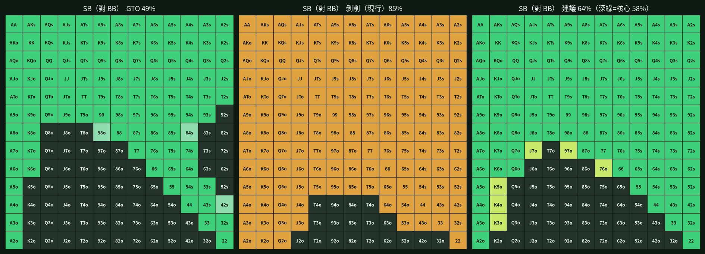
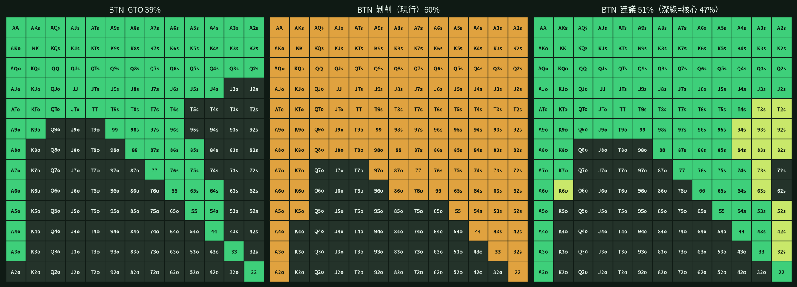
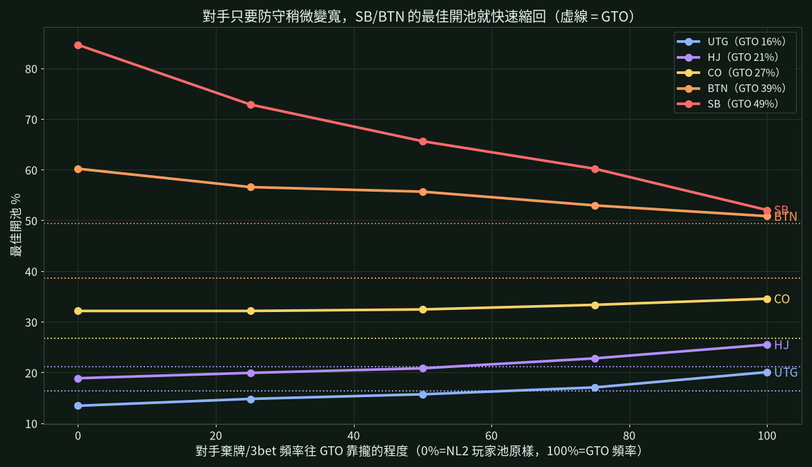

# 翻前開池（RFI）全面重新檢查

產出時間：2026-10-30 23:40（台北時間）｜純分析，網站、solver repo 和線上範圍**都沒有改**。
模型：6-max、100bb、BTN 前開 2.5bb、SB 開 3bb，抽水模型同現行 solver（`preflop/pfsolve.py`）。對手模型用 NL2 玩家池，共 233 萬手（`pool_stats.json`）。

---

## 一、結論（先講答案）

**現行剝削版開太寬，問題主要在 SB 和 BTN。** 84% 和 60% 只有在「對手完全照 NL2 平均那樣棄牌，而且看到你開這麼寬也不調整」時才成立。只要對手防守稍微變寬，或你翻後打得比模型假設差一點，最後那 20–25% 的爛牌就會變成虧錢。

| 位置 | GTO（現行） | 剝削（現行） | **建議開池** | 新手先用（核心） | 公開 solver 參考 |
|---|---|---|---|---|---|
| UTG | 16% | 13% | **13%** | 12% | 17–18% |
| HJ | 21% | 19% | **16%** | 15% | 21–22% |
| CO | 27% | 32% | **25%** | 24% | 28–29% |
| BTN | 39% | 60% | **51%** | **47%** | 42–44% |
| SB | 49% | 85% | **64%** | **58%** | 43%（只有加注或棄牌）|

- 「建議」= 在 9 個合理情境中，至少 7 個情境開池都是正 EV 的牌。
- 「核心」= 9 個情境**全部**正 EV 的牌，最穩，新手建議先用這個，BTN 和 SB 尤其如此。
- 錢的大小：如果玩家池**真的**跟模型一樣，改用「建議」範圍，每 100 手總共只少賺約 **0.18bb**；改用「核心」約少 **0.33bb**。但只要對手稍微調整，建議範圍反而**多賺** 0.25–0.3bb/100，最壞的情況下 SB 一個位置就差到約 2bb/100（以 SB 的手數計）。少賺很少，避開的風險較大，所以建議收緊。
- 開池範圍寬窄的整體價值本來就很小：GTO 和完整剝削之間每 100 手總共只差約 0.5bb。你 10/30 覆盤的漏洞（3bet 0%、盲注防守、翻後 c-bet）比這大很多。

### 各位置的建議範圍（「建議」欄）

- **UTG 13%**：AA–66、所有同花 A、KQs–KTs、QJs–QTs、JTs、AKo–ATo。
- **HJ 16%**：UTG 範圍，加上 J9s、T9s、98s、KQo、KJo。
- **CO 25%**：AA–44、所有同花 A、KQs–K5s、QJs–Q8s、JTs–J8s、T9s–T8s、98s–97s、87s–86s、76s、65s、AKo–A8o、KQo–KTo、QJo–QTo。
- **BTN 47%（核心）**：
  - 所有對子，以及幾乎所有同花牌。只丟最爛的那些：T3s–T2s、94s–92s、84s–82s、73s–72s、63s–62s、52s、42s、32s。
  - 不同花：A2o 以上、K7o 以上、Q9o 以上、J9o、T9o。
  - 「建議 51%」是在核心之外，再加上 T3s–T2s、94s–92s、84s–82s、73s、63s、52s、42s、32s 這些爛同花牌和 K6o。這些牌在模型裡是 +EV，但第五節說明這主要是模型對同花牌太樂觀，所以不建議加。
- **SB 58%（核心）**：
  - 所有對子和所有同花牌。
  - 不同花：A2o 以上、K6o 以上、Q6o 以上、J8o 以上、T8o 以上、98o、87o。
  - 「建議 64%」再加上 K5o–K3o、J7o、97o、76o。
  - 現行 85% 多開的那些牌（Q5o–Q2o、J6o–J3o、T7o–T4o、96o、95o、86o、85o、75o、65o、64o、54o、53o、43o、K2o）都應該拿掉。

範圍格子圖在 `rfi_grids_all.png`，各位置也有單獨一張 `rfi_grid_<位置>.png`。

---

## 二、各位置的剝削差異從哪裡來

剝削版的範圍是怎麼來的：把 NL2 玩家池在每個節點的「棄牌、跟注、3bet 頻率」固定住，再算出你對付這組頻率的最佳回應。

| 你開池 | 後面的人 | 玩家池 棄/跟/3bet | GTO 棄/跟/3bet | 影響 |
|---|---|---|---|---|
| UTG | HJ / CO / BTN / SB / BB | 81/13/6、79/15/6、76/17/7、76/18/6、63/32/5 | 86/8/5、86/9/5、86/8/5、85/10/5、73/22/5 | 玩家池**跟太多**，所以開池要比 GTO 緊 |
| HJ | CO / BTN / SB / BB | 79/14/7、76/17/7、76/18/6、62/32/6 | 83/11/6、83/11/6、82/11/7、69/25/6 | 一樣，要比 GTO 稍緊 |
| CO | BTN / SB / BB | 76/16/8、75/18/7、61/33/6 | 77/15/8、78/14/8、65/27/8 | 和 GTO 很接近，3bet 少一點 |
| BTN | SB / BB | 73/18/9、58/34/8 | 70/19/11、55/34/11 | 盲注 3bet 少，BB 多棄 3–4 個百分點 |
| SB | BB | **54/37/9** | **41/45/14** | BB 多棄 13 個百分點、3bet 少三分之一，所以 SB 可以開很寬 |

重點：前位（UTG、HJ）面對的 NL2 玩家「太愛跟注」，所以要**比 GTO 緊**；後位（BTN、SB）面對的盲注「太愛棄牌」，所以可以**比 GTO 寬**。CO 介於中間。

---

## 三、穩健性測試（每個位置最佳開池 %）

每一欄都是「在那個情境下，最賺錢的開池範圍有多寬」。

| 情境 | UTG | HJ | CO | BTN | SB |
|---|---|---|---|---|---|
| 0 現行模型（玩家池原樣） | 13.4 | 18.9 | 32.1 | 60.2 | 84.6 |
| 對手頻率往 GTO 靠攏 25% | 14.8 | 19.9 | 32.1 | 56.6 | 72.9 |
| 往 GTO 靠攏 50% | 15.7 | 20.8 | 32.4 | 55.7 | 65.6 |
| 往 GTO 靠攏 75% | 17.0 | 22.8 | 33.3 | 52.9 | 60.2 |
| 往 GTO 靠攏 100% | 20.1 | 25.5 | 34.5 | 50.8 | 52.0 |
| BB 對 SB 棄牌改成 50% | – | – | – | – | 71.0 |
| BB 對 SB 棄牌改成 45% | – | – | – | – | 61.1 |
| 對手會因你開寬而調整（輕度） | 14.3 | 19.2 | 29.4 | 51.7 | 64.7 |
| 對手會因你開寬而調整（強） | 14.8 | 19.2 | 27.9 | 46.6 | 58.1 |
| 新手翻後打折 5% | 12.8 | 17.9 | 29.7 | 59.3 | 78.3 |
| 新手翻後打折 10% | 12.8 | 16.3 | 29.7 | 57.5 | 74.7 |
| 對手防守範圍改成「像 GTO 的形狀」 | 13.1 | 14.9 | 25.8 | 56.0 | 83.7 |
| 靠攏 50% ＋ 打折 5% | 15.1 | 19.9 | 31.2 | 53.8 | 62.0 |
| GTO 形狀 ＋ 輕度調整 ＋ 打折 5%（合理悲觀） | 13.1 | 15.8 | 25.2 | 46.6 | 59.3 |
| 強調整 ＋ 打折 10%（很悲觀） | 13.1 | 17.6 | 26.7 | 46.3 | 52.9 |
| 對照：開池後對手完全照 GTO 打 | 16.1 | 20.8 | 27.0 | 38.5 | 49.9 |

最後一行把開池後的對手全部換成 GTO 策略，結果和 GTO 解幾乎一樣（16/21/27/39/50），代表這套計算方法本身是對的。

### 情境說明
- **往 GTO 靠攏 x%**：開池後面每個人的棄牌、跟注、3bet 頻率，從玩家池數字往 GTO 移動 x%。
- **對手調整**：玩家池的數字是對手面對「一般開池者」時打出來的，例如 SB 一般只開 35%。如果你開得比一般人寬，對手每多看到 1 個百分點的開池，就少棄 0.25 個百分點（輕度）或 0.5 個百分點（強）。這個關係會反覆迭代到你的範圍和對手的反應都穩定為止。
- **新手翻後打折**：你沒位置時，所有牌的實現勝率乘以 0.95 或 0.90，弱的不同花牌再乘一次；有位置時，只有弱的不同花牌打一半的折。
- **GTO 形狀**：原模型假設玩家池「拿勝率最高的牌跟注或 3bet，其餘棄牌」，所以會用 K2o 跟注、65s 棄牌，這其實很不合理。這個情境改成依照 GTO 會繼續玩的牌排序來分配，但棄牌、跟注、3bet 的頻率不變。
- **9 個合理情境**：現行模型、GTO 形狀、靠攏 50%、GTO 形狀加靠攏 50%、輕度調整、打折 5%、靠攏 50% 加打折 5%、GTO 形狀加打折 5%、GTO 形狀加輕度調整加打折 5%。「建議」就是其中至少 7 個情境正 EV 的牌，「核心」是 9 個全部正 EV 的牌。

### 各範圍在各情境下的 EV
單位是「在這個位置每 100 手、比全部棄牌多賺的 bb」。

| 位置 | 情境 | GTO | 現行剝削 | 建議 | 核心 |
|---|---|---|---|---|---|
| SB | 現行模型 | 11.58 | **13.20** | 12.71 | 12.35 |
| SB | 靠攏 50% | 10.69 | 10.51 | **11.17** | 11.06 |
| SB | BB 對 SB 棄牌 45% | 10.34 | 9.37 | **10.53** | **10.54** |
| SB | 強調整 | 10.02 | 8.58 | 10.07 | **10.14** |
| SB | 很悲觀 | **9.20** | 7.49 | 9.08 | **9.21** |
| SB | 對手照 GTO 打 | **9.13** | 6.73 | 8.72 | 8.97 |
| BTN | 現行模型 | 12.37 | **13.61** | 13.37 | 13.03 |
| BTN | 靠攏 50% | 12.11 | 12.74 | **12.77** | 12.57 |
| BTN | 強調整 | 11.85 | 11.62 | **12.04** | **12.04** |
| BTN | 合理悲觀 | 10.41 | 10.08 | 10.46 | **10.54** |
| CO | 現行模型 | 11.47 | **11.63** | 11.40 | 11.37 |
| CO | 合理悲觀 | 9.44 | 9.17 | **9.46** | **9.47** |

UTG 和 HJ 在所有情境下，各範圍之間的差距都小於 0.35bb/100，選哪個都差不多。

### 邊緣牌：開了幾乎沒差，或者會因情境變成虧錢的牌
單位是每次開池比棄牌多賺或多虧的 bb。

| 牌 | 現行模型 | 靠攏 50% | 輕度調整 | 合理悲觀 | 對手照 GTO 打 |
|---|---|---|---|---|---|
| SB 72o | −0.09 | −0.29 | −0.32 | −0.32 | −0.50 |
| SB T4o | 0.00 | −0.19 | −0.22 | −0.21 | −0.38 |
| SB Q5o | +0.11 | −0.04 | −0.06 | −0.10 | −0.18 |
| SB 86o | +0.17 | +0.01 | −0.01 | −0.05 | −0.17 |
| SB K5o | +0.23 | +0.11 | +0.09 | 0.00 | −0.04 |
| SB J8o | +0.20 | +0.07 | +0.06 | +0.04 | −0.05 |
| SB A2o | +0.44 | +0.32 | +0.31 | +0.20 | +0.19 |
| BTN 86o | +0.02 | −0.05 | −0.10 | −0.16 | −0.11 |
| BTN K5o | +0.01 | −0.04 | −0.07 | −0.11 | −0.08 |
| BTN Q9o | +0.10 | +0.05 | +0.03 | +0.01 | +0.01 |
| CO A5o | +0.01 | +0.02 | −0.01 | −0.11 | +0.03 |
| UTG KQo | −0.01 | +0.03 | 0.00 | −0.05 | +0.10 |

可以看出，現行 84% 多開的那些牌，在最好的情況下每次也只多賺 0.0–0.2bb，對手稍微調整就變成負的。

---

## 四、和公開 solver 對照（只列我實際打開過的頁面）

| 來源 | UTG/LJ | HJ | CO | BTN | SB | BB 對 BTN 防守 | BB 對 SB 防守 |
|---|---|---|---|---|---|---|---|
| Pokalab（GG NL50 抽水，2.5x，SB 3x，只有加注或棄牌）[^1] | 17.6 | 22.3 | 29.1 | 43.6 | 43.5 | 40.3%（棄 59.7） | 51.6%（棄 48.4） |
| DEEPFOLD NL50（2.5x）[^2] | 17.6 | 21.5 | 27.8 | 41.5 | 42.7 | – | – |
| SolvePoker MonkerSolver 100bb（抽水 5%，上限 2bb）[^3] | 16.8 | 20.9 | 27.7 | 43.4 | 加注 38.1＋平跟 10.4 | 39.9% | – |
| **我們的 GTO** | 16.3 | 21.2 | 26.8 | 38.6 | 49.3 | **45.3%** | **58.7%** |

- UTG、HJ、CO 和公開 solver 差 1–2 個百分點以內，可信。
- 我們的 BTN 比公開 solver 緊 3–5 個百分點，SB 寬約 6 個百分點，BB 防守也寬約 5–7 個百分點。原因大概是實現勝率表（見第五節）和 3bet 尺寸不同：我們 OOP 3bet 是 4 倍（10bb），Pokalab 是 13bb。
- **更正先前的說法**：先前說「一般 solver 的 BB 防守 BTN 約一半甚至更多，所以我們的 45% 偏緊」，這是錯的。公開 solver 在有抽水時大約是 **40%**，所以我們的 45% 其實**略寬**，不是偏緊。你覺得 BB 範圍很寬，這個直覺是對的。

[^1]: https://www.pokalab.com/tools/preflop-charts
[^2]: https://deepfold.co/en/blog/preflop-rfi-guide
[^3]: https://solvepoker.app/data/nlhe-stack-depth.csv

---

## 五、模型的怪異之處

1. **BB 對 BTN 時，J9o 防守但 Q9o 棄牌。** 實際上 J9o 不是跟注，而是拿來 3bet 詐唬（89%）；Q9o 則是 100% 棄牌。原因是 playability 表只看兩張牌之間的「間隔」：Q9o 間隔 2，被當成垃圾牌（0.84）；J9o 間隔 1，得到 0.90。這是**表格造成的假象**。
   - 驗證方法：只把 Q9o、Q8o、K9o、K8o 這類牌調到 0.90，重新解 GTO（`playfix.py`，結果在 `gto_playfix.json`）。
   - 驗證結果：Q9o 變成跟注 68%、3bet 32%；K8o 變成 100% 跟注；J9o 反而變成大多棄牌（90%）。BB 對 BTN 的棄牌率從 54.7% 變成 53.6%。各位置的開池變化都在 0.2 個百分點以內。
   - 結論：**這個怪異之處只影響個別手牌，不影響開池 % 的結論**。
2. **BTN 和 SB 的寬範圍裡有很多爛同花牌**（32s、42s、92s、83s……），卻不開 Q8o、J8o 這類牌。原因是所有間隔 3 以上的同花牌一律給 1.06，太樂觀了。公開 solver 在 BTN 會固定開 Q9o、J9o、T9o，同花牌只開到大約 J5s、T6s、96s、86s、75s、54s 左右。這也是我建議 BTN 用「核心」47% 的原因。
3. **我們的 GTO 在 BTN 只開 39%，而且不開 Q9o、J9o、T9o**，但公開 solver 是固定開這些牌。原因同第 1 點，不同花的連張被低估了。
4. **樹的簡化會讓 BTN 和 SB 開池看起來太賺。** 模型裡，第一個跟注的人一出現，後面的人就自動棄牌：沒有冷跟加跟注（overcall），也沒有 squeeze。實際上，SB 跟注 BTN 後，BB 常常會用很好的賠率一起跟，形成多人底池，而爛牌在多人底池裡最吃虧。所以 BTN、SB 的寬範圍在模型中被高估了。
5. **剝削版假設玩家池用「勝率最高的牌」繼續玩**（K2o 跟注、65s 棄牌）。這會讓對手的防守範圍看起來比實際差，所以 CO 的剝削範圍被放大成 32%。改成「GTO 形狀」後，CO 只剩 26%。

---

## 六、這些範圍是怎麼算出來的（白話版）

1. **偷盲的基本算術**：SB 開 3bb，真正多冒的風險是 2.5bb（0.5bb 本來就在桌上），要搶的是底池裡的 1.5bb。如果每次被跟注或被 3bet 都直接輸，BB 至少要棄 2.5 ÷ 4 = **62.5%**，爛牌偷盲才不虧。BTN 開 2.5bb 搶 1.5bb，兩個盲注合起來要棄 2.5 ÷ 4 = 62.5%。
2. **棄牌勝率（fold equity）**：實際上被跟注後還有翻後可以打，不會全輸，所以不需要 62.5% 那麼高。對手棄得越多，你能拿來偷的牌就越爛。NL2 的 BB 對 SB 棄 54%，GTO 只棄 41%，差了 13 個百分點，所以 SB 可以多開很多爛牌。
3. **實現勝率（realization）**：被跟注後，你的牌對上對手範圍有一個「純勝率」，但翻後不一定拿得到。有位置、同花、連張能拿到比較多，沒位置的不同花爛牌拿到比較少。模型用一張「可玩性表」，再加上位置折扣來估計。**這是整個模型最不準的地方**，第五節那些怪異之處都是從這裡來的。
4. **抽水**：只要看到翻牌，底池就會被抽水。小底池抽得比例最高（約 7–14%），所以邊緣牌被跟注後更難賺。
5. **CFR（GTO 版）**：讓 6 個虛擬玩家互相打幾千輪，每一輪各自調高「後悔沒做」的動作的頻率，最後收斂到誰都無法單方面再改進的策略。現在的誤差小於 0.1 mbb/手。
6. **最佳回應（剝削版）**：把其他 5 個人固定成 NL2 玩家池的頻率，只讓你一個人調整。對每手牌算出「開池」和「棄牌」各自的 EV，哪個大就做哪個。
7. **為什麼剝削版會跳那麼大**：GTO 範圍邊緣上的牌，開和棄的 EV 本來就幾乎一樣（差 ±0.05bb）。對手頻率只要動一點，這一整群牌就會一起從「開」翻成「棄」，或反過來，所以範圍 % 會劇烈跳動，但 EV 的變化很小。這也是看到「最佳範圍 84%」時，不能直接照用的原因。

### 不確定的假設（由大到小）
1. 實現勝率表，也就是可玩性和位置折扣。
2. 玩家池的反應：對手會不會因為你開很寬而調整。NL2 的數字是平均值，常客會調整。
3. 樹的簡化：沒有多人底池和 squeeze，SB 也不能平跟（limp）。
4. 玩家池的數據混了不同的開池尺寸：例如 SB 有 53% 開到 2.6–3x，21% 開到 2x。
5. 假設翻後雙方都打得像 GTO。新手實際上會少拿一些 EV，這部分已經用「打折」情境測試過。

---

## 七、檔案
- `audit.py`：各情境的最佳回應計算。只讀取 `../preflop`，不修改任何東西。
- `analyze_audit.py`、`final.py`：統計和表格，結果在 `results.json`、`summary.json`、`final.json`。
- `playfix.py`、`gto_playfix.json`：Q9o 怪異之處的驗證。
- `charts.py`：產生 `rfi_grids_all.png`、`rfi_grid_{UTG,HJ,CO,BTN,SB}.png`、`rfi_sensitivity.png`。

